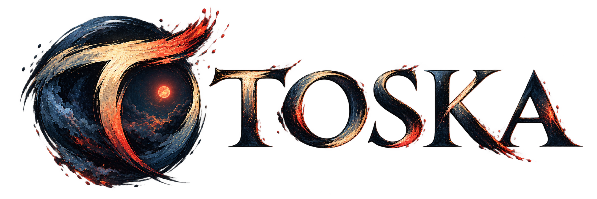
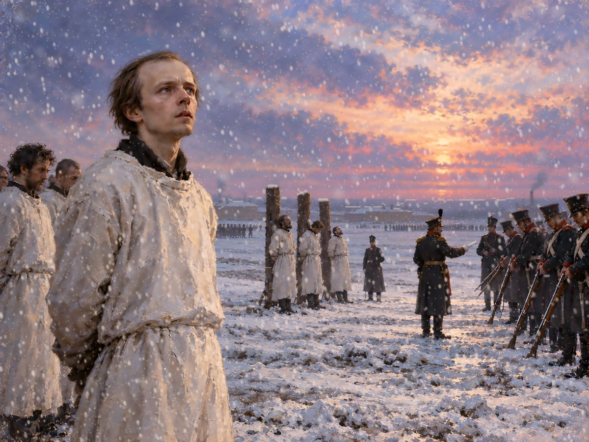
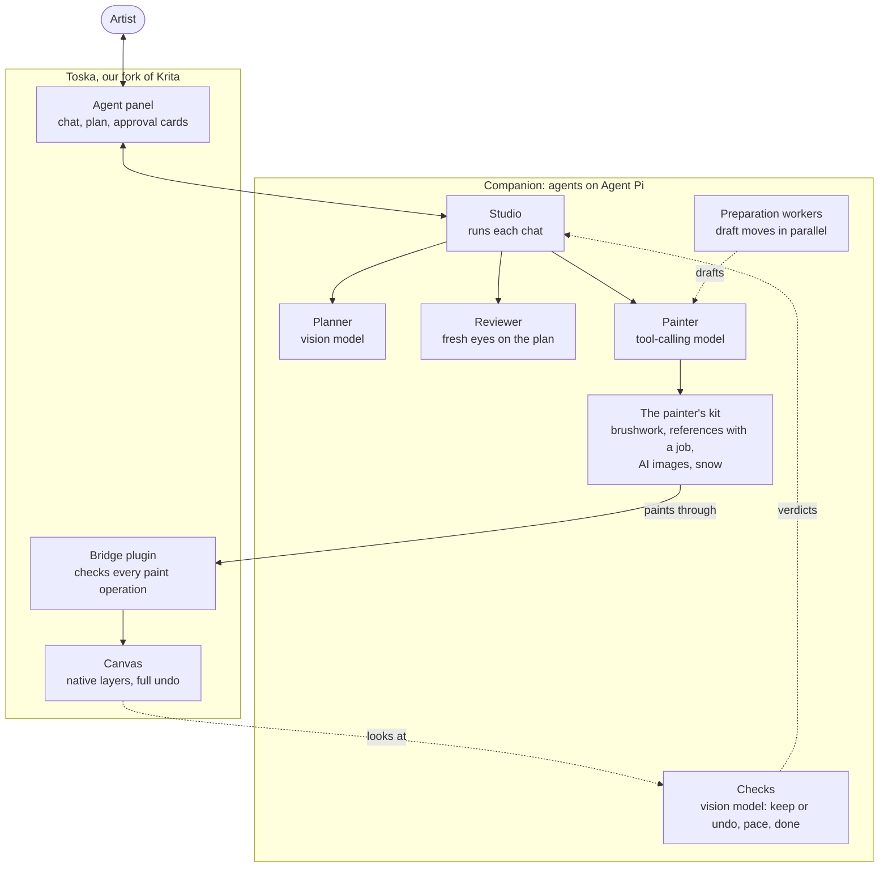

<p align="center">
  
</p>

**Toska** - Toska (тоска) is a Russian word expressing a deep, often indescribable longing. I chose it out of my appreciation for Russian literature and the emotion the word captures. I'm not a native Russian speaker, and the name reflects a literary and artistic interest. I believe there's a particular kind of **Toska** in creativity, the longing to bring something you can vividly imagine into existence, but not quite having the means to express it. 


**Agentic painting inside Krita.** Toska is a fork of [Krita](https://krita.org) (master, Qt 6) with an AI painter built in.
You chat with it in a panel. It makes one substantial move at a time on layers you can undo, and you decide whether each move
stays or type a correction. A separate reviewer checks the result against your reference. Underneath, Toska adds the engine
features a script needs to paint well, among them pen pressure and tilt, background stroke jobs, one step agent moves and named
regions of the canvas. 

<p align="center"><br>
<em>Pyat' minut</em> (Five Minutes). Dostoevsky on Semyonovsky Square in 1849, waiting to be shot, not knowing the Tsar had already pardoned him. Painted in Toska.</p>

> Status: pre-alpha, built and run on macOS (Apple silicon). Toska is based on Krita, the free digital painting program by
> the Krita developers ([krita.org](https://krita.org)), and is distributed under the GNU GPL, as Krita is. Krita is a
> trademark of the Krita Foundation. Toska is an independent fork, not affiliated with or endorsed by the Krita project.

## What it can do

- **Ask, Plan, Agent and Autopilot.** Ask and Plan only talk. Agent makes one substantial move per message (a whole sky of
  strokes, say), and you keep it or take it back. Autopilot paints an agreed plan through to the end, or until you press Stop.
- **Every move can be undone.** Strokes go on native Krita layers through Krita's own brush engine, and Undo takes back the
  whole move.
- **References with a job.** Each reference image says what it is for: overall direction, a character's likeness, composition,
  palette or material. When the goal picture is much smaller than the canvas, Toska sharpens it on your Mac before painting.
- **It checks its own work.** A vision model looks at each pass as it lands and undoes one that made the painting worse. At the
  end of a step, a reviewer in a fresh session judges the canvas against the plan and gives its evidence.
- **Paint only here.** Type a part ("the sky", "the left buildings") and Toska outlines it. Krita then blocks every stroke
  outside that outline.
- **AI images, only when you allow them.** A move can use a generated image as an asset to repaint, or a canvas edit reference
  that shows a change before anything is painted. Both stay off until you give the chat an allowance.
- **Effects that need a method,** such as falling and settled snow: thousands of soft flakes in depth, with faces kept clear.

## How it works



Toska is Krita with an agent built in. A small plugin inside it is the only part that changes the painting. It checks every
operation before running it and puts each pass on a layer you can undo.

The agents run beside it in a companion app built on [Agent Pi](https://github.com/earendil-works/pi), an open-source agent framework. Each chat has a studio that hands out the work. The planner reads
your references and breaks the job into steps. Then the painter makes one move at a time, while preparation workers draft the
next ones in parallel. When a step is done, a reviewer comes in with fresh eyes and judges the result against the plan. Between those, a
fast vision model looks at each pass as it lands and decides whether to keep it, slow down or call the step done.

Anything that needs your say shows up as a card in the panel, so you decide what stays.

For development and testing, an MCP server (`creative-agent/krita-mcp/server.py`) lets a coding agent such as Claude Code drive
Toska the same way. You don't need it to paint.

More detail: [architecture](creative-agent/krita-creative-agent/docs/architecture.md),
[safety](creative-agent/krita-creative-agent/docs/safety.md),
[decision models](creative-agent/krita-creative-agent/docs/decision-models.md) and
[tracing](creative-agent/krita-creative-agent/docs/tracing.md).

## What is in this repository

| Path | What it is |
|---|---|
| everything outside `creative-agent/` and `agent/` | Krita itself, with our changes (listed file by file in [AGENT-FORK.md](AGENT-FORK.md)) |
| `creative-agent/krita-mcp` | the agent's Python plugin for Krita, and an MCP server for other clients |
| `creative-agent/krita-creative-agent` | the companion (Node/TypeScript): models, the painter and reviewer, tools, tests |
| `creative-agent/krita-native` | a native helper for stock Krita 5.3.3 (frozen: the fork has these abilities built in) |
| `creative-agent/openspec` | the specs, design and task list for the fork |
| `agent/` | build, test, CI and publishing scripts |
| `docs/krita/` | Krita's own README and developer notes, unchanged |

The earlier plugin-only repository is the branch `plugin-only` of this repository.

## Requirements

- A Mac with Apple silicon, macOS 14 or later.
- An API key for the painter model you choose, such as one from OpenRouter. A decision model for the vision checks
  is optional. Without one, Toska paints without those checks.
- Download the app from [Releases](https://github.com/yak1234/toska/releases). It is signed and notarized by Apple. Or
  build it yourself as below, which takes a few hours.

## Build and test (macOS)

```sh
agent/fetch-deps.sh            # once: the dependency tree and tools
agent/build-macos.sh --tests   # configure, build and install into _install (a full build takes hours)
agent/run-tests.sh TestDocument TestStrokeJobs   # C++ tests, safely (see the header of the script)
agent/ci.sh                    # every suite we own: plugin Python, companion JS and typecheck, C++ programs
agent/run.sh                   # start Toska (its own settings folder and bridge port, never stock Krita's)
```

## Licence

Krita is GPL-3.0-or-later (see `COPYING`), and the combined work is distributed under GPL-3.0-or-later. New files in Krita's
libraries keep that library's licence (LGPL-2.0-or-later in `libs/libkis`, GPL-2.0-or-later in `libs/image` and `libs/ui`),
copyright Yakub Rabiutheen, so that they can be offered upstream. The agent's own code (`creative-agent/`, `agent/`) is
GPL-3.0-or-later.
