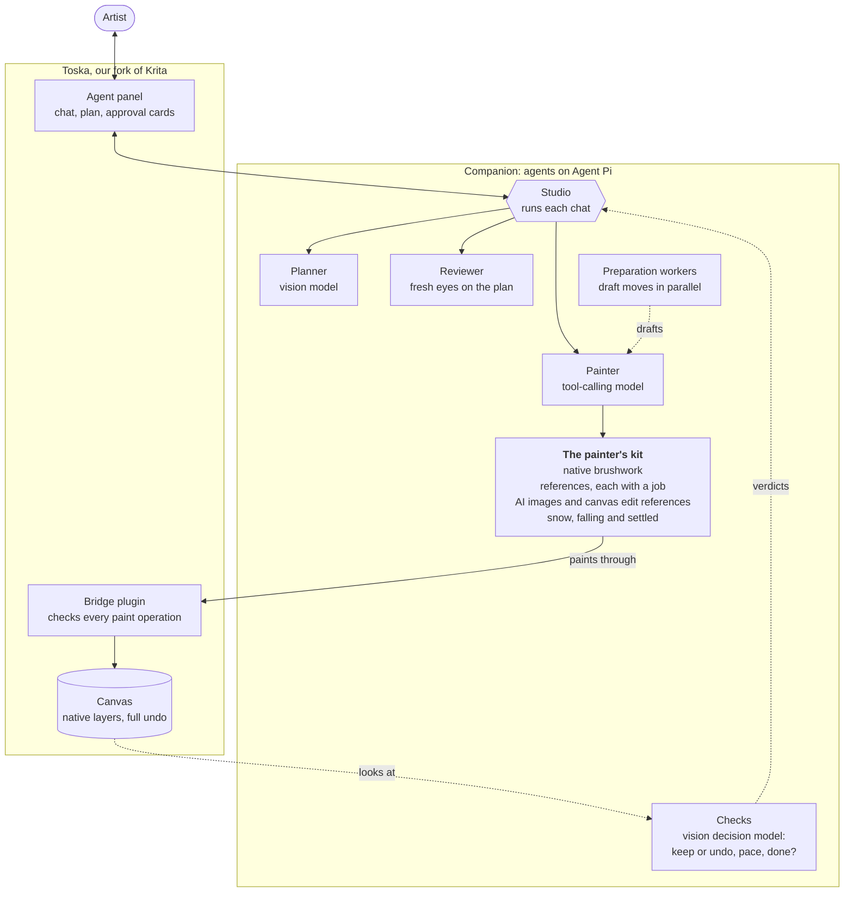

# Toska

<p align="center"></p>

**Agentic painting inside Krita.** This repository is a fork of [Krita](https://krita.org) (master, Qt6) with an AI painter built
in: you chat with it in a panel, it makes one substantial move at a time on reversible layers, you keep it, undo it or correct it,
and an independent visual reviewer checks the result against your reference. Toska adds the parts of Krita's engine that a
script needs to paint well (pen pressure, tilt and speed, async stroke jobs, one-step agent moves, named regions of the canvas,
undoable tools), and ships the agent with the app.

> Status: pre-alpha, built and run on macOS (Apple silicon). Toska was called "Krita Agent" while it was being made; the
> repository, the settings folder (`KritaAgent`) and the app's bundle identifier (`local.kritaagent`) keep that name for now (see
> AGENT-FORK.md, "Product name: Toska"). Toska is based on Krita, the free digital painting program by the Krita developers
> ([krita.org](https://krita.org)), and is distributed under the GNU GPL, as Krita is. Krita is a trademark of the Krita
> Foundation; Toska is an independent fork and is not affiliated with or endorsed by the Krita project.

## What it can do

- **Four ways to work.** Ask and Plan only talk. Agent makes one substantial move per message (a whole sky of strokes, say), and
  you keep it, undo it or type a correction. Autopilot paints an agreed plan through to the end, or until you press Stop.
- **Every move is reversible.** Strokes go on native Krita layers through Krita's own brush engine, and Undo takes back the whole
  move.
- **References with a job.** Each reference image says what it is for: overall direction, a character's likeness, composition,
  palette or material. A goal picture much smaller than the canvas is sharpened on your Mac first.
- **It checks its own work.** A separate reviewer judges the result against the plan, with evidence. With Decision checks on, a
  vision model also looks at each pass as it lands and undoes one that made the painting worse.
- **Paint only here.** Name a part ("the sky", "the left buildings"); Toska finds it and Krita blocks every stroke outside it.
- **AI images, only if you allow them.** The painter can ask for an image to repaint as an asset, or a canvas edit reference that
  shows a change before anything is painted. Both are off until you give the chat an allowance.
- **Effects that need a method,** such as falling and settled snow, painted as thousands of soft flakes in depth with faces kept
  clear.

## How it works



Toska is our fork of Krita. Inside it, a small plugin owns the canvas: it checks every operation before it runs, paints on Krita's own main thread with native brushes, and keeps every pass on a layer you can undo. The agents live next door in the companion, built on Agent Pi. The studio runs each chat and hands work to the agent that suits it: a planner that reads your references and splits the job into steps, a painter that makes one move at a time, preparation workers that draft moves in parallel, and a reviewer that comes in with fresh eyes. A fast vision model checks each pass as it lands and decides whether it stays, whether to slow down, and whether the goal has been reached. You stay in the loop through cards in the panel.

For development and testing, an MCP server (`creative-agent/krita-mcp/server.py`) lets a coding agent such as Claude Code drive Toska the same way. You don't need it to paint.

More detail: [architecture](creative-agent/krita-creative-agent/docs/architecture.md),
[safety](creative-agent/krita-creative-agent/docs/safety.md),
[decision models](creative-agent/krita-creative-agent/docs/decision-models.md) and
[tracing](creative-agent/krita-creative-agent/docs/tracing.md).

## What is in this repository

| Path | What it is |
|---|---|
| everything outside `creative-agent/` and `agent/` | Krita itself, with our changes (listed file by file in [AGENT-FORK.md](AGENT-FORK.md)) |
| `creative-agent/krita-mcp` | the agent's Python plugin for Krita, and an MCP server for other clients |
| `creative-agent/krita-creative-agent` | the companion (Node/TypeScript): models, the painter and reviewer, tools, tests |
| `creative-agent/krita-native` | a native helper for stock Krita 5.3.3 (frozen: the fork has these abilities built in) |
| `creative-agent/openspec` | the specs, design and task list for the fork |
| `agent/` | build, test, CI and publishing scripts |
| `README.krita.md` | Krita's own README, unchanged |

The earlier plugin-only repository lives on in the branch `plugin-only` of this repository.

## Build and test (macOS)

```sh
agent/fetch-deps.sh            # once: the dependency tree and tools
agent/build-macos.sh --tests   # configure, build and install into _install (a full build takes hours)
agent/run-tests.sh TestDocument TestStrokeJobs   # C++ tests, safely (see the header of the script)
agent/ci.sh                    # every suite we own: plugin Python, companion JS and typecheck, C++ programs
agent/run.sh                   # start Toska (its own settings folder and bridge port; never stock Krita's)
```

## How changes get here

Work is done on short-lived branches, reviewed by a fresh reviewer, and merged into `krita-agent` locally. **Every merge that
passes `agent/ci.sh` and the pre-publication check (`agent/prepublish-check.sh`: secrets, paintings, personal data) is published
to `main` of this repository by `agent/publish.sh`.** `main` is therefore always the last state that passed its tests.

The public history is a replay of the local main line: its first commit is Krita's tree at the commit this fork started from
(Krita's own history, about 10 GB, stays at [invent.kde.org/graphics/krita](https://invent.kde.org/graphics/krita)), followed by one
commit per merge or change, with its message and author. Krita's master is merged into the fork monthly (see AGENT-FORK.md).

Continuous integration on GitHub is deliberately light (the agent's Python and JS suites, on free hosted runners). Building Krita
takes hours and runs locally.

## Licence

Krita is GPL-3.0-or-later (see `COPYING`); the combined work is distributed under GPL-3.0-or-later. New files in Krita's libraries
carry that library's licence (LGPL-2.0-or-later in `libs/libkis`, GPL-2.0-or-later in `libs/image` and `libs/ui`), copyright
Yakub Rabiutheen, so that they can be offered upstream. The agent's own code (`creative-agent/`, `agent/`) is GPL-3.0-or-later.
