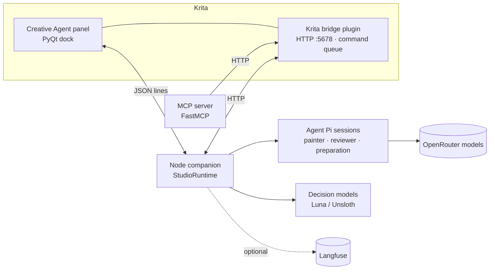

# Krita Creative Agent

[](https://github.com/yak1234/krita-creative-agent/actions/workflows/ci.yml)
[](LICENSE)
[](https://github.com/yak1234/krita-creative-agent/releases)

**Agentic painting inside [Krita](https://krita.org/), the way Cursor does agentic coding.** You chat with it in a Krita panel. In **Agent** mode it makes one substantial move at a time (say, about 200 swirl strokes for Starry Night's sky), and you keep it, undo it or type a correction. In **Autopilot** it takes an agreed plan and paints until an independent visual reviewer passes the result against your reference, or until you press Stop. Every stroke goes on a reversible, native Krita layer, and your original artwork is never overwritten.

<!-- Demo: record a short run (Krita + panel side by side) and save it as docs/media/demo.gif -->


## Highlights

- **Four modes.**
  - **Ask** and **Plan** are read-only. Plan asks the artistic questions that matter, then proposes a structured brief: locked requirements, freedoms, a painting order and "finished when" checks.
  - **Agent** is collaborative. Each message becomes one substantial move: a batch of native painting actions, sized to a visible step and grouped so that **Undo** hides the whole move. **Keep** paints the next move; typing a correction refines it.
  - **Autopilot** paints the accepted plan by itself, with batching, decision-model pacing and an independent review.
- **Native, reversible painting.** Strokes, recipes (procedural coverage), contour fills, reference transfer and toolbox edits all run through Krita's own brush engine onto new or copied layers. A pass history lets you compare, fade or reject any pass.
- **An independent reviewer.** A separate model session judges the whole canvas against every requirement, with evidence per check, and the host decides completion from those checks.
- **Fast autonomous runs.** Several painting actions are batched per model call, the model context stays lean, full saves are deferred, and a decision model paces the run (see [Speed](#speed)).
- **Decision models, on any endpoint.** Fast, typed decisions (`noul` / `choice` / `score`) route requests, detect defects a pass introduced, score progress and pace runs.
  - Endpoints: OpenRouter (every decision model it serves, listed live), OpenAI's Decisions API, TypeSafe, or your own System One endpoint, such as Unsloth Studio serving a model you trained.
  - Visual decisions run only on models that pass a two-image check ([docs](docs/decision-models.md)).
- **API keys only.** Model and decision connections use API keys, so a lapsed OAuth sign-in can't break a chat.
- **Observability and a training-data pipeline.** Optional [Langfuse](https://langfuse.com) tracing records each chat as a session: every model call, tool call, review score and typed decision, with canvas images. A labelling queue and an exporter turn those into decision-model training rows ([docs](docs/tracing.md)).
- **MCP server.** `mcp-server/` exposes the same Krita bridge to Claude or any other MCP client.

## Architecture



The **plugin** (`plugin/kritamcp`) runs inside Krita. It owns the canvas, validates every operation, paints on Krita's main thread and saves the working `.kra`. The **companion** (`companion/`) runs the agent loop: planning, tools, batching, pacing, reviews and tracing. More detail is in [docs/architecture.md](docs/architecture.md).

## Speed

Measured from Langfuse sessions with `companion/scripts/benchmark-run.mjs` (Starry Night reconstruction, same model):

| | Painting time | Painter model calls | Time in model calls |
|---|---|---|---|
| Before (v0.2) | 76.2 min | 295 | 62.1 min |
| v1.0 | _run `benchmark-run.mjs` after a v1.0 run and fill in_ | | |

The bottleneck was one model round trip per small brush action, not painting. v1.0 batches actions, strips host bookkeeping from model context (a single result used to carry about 59k characters), keeps only the newest canvas images, defers full saves, and lets a decision model advance plan steps and call reviews instead of painter turns.

## Install (macOS)

Requirements: macOS on Apple silicon or Intel (tested on macOS 15.6, Apple silicon), Krita 5.3 (tested on 5.3.3), and an OpenRouter API key. Node is not required: the panel fetches its own.

1. Download the latest release bundle from [Releases](https://github.com/yak1234/krita-creative-agent/releases) and unzip it.
2. Install it, choosing a folder for your paintings:
   ```sh
   python3 install.py --bundle . --project ~/Pictures/Krita-Agent
   ```
3. In Krita, enable **Krita MCP Bridge** under *Settings → Configure Krita → Python Plugin Manager*, then restart Krita.
4. Open a document and choose *Settings → Dockers → Creative Agent*. On first start the panel downloads the pinned Node runtime once (about 50 MB from nodejs.org, checksum-verified; shared by every later release). Then connect OpenRouter in the panel's settings.

Optional: copy [`.env.example`](.env.example) to `.env` in your paintings folder and add Langfuse keys to trace every chat.

## Develop

```sh
cd companion && npm ci --ignore-scripts && node --test tests/*.test.mjs
uv run --with httpx python -m unittest discover -s companion/tests -p 'test_*.py'
uv run --with pytest --with httpx --with fastmcp pytest mcp-server/tests
uv run --with pyqt5 python companion/tests/ui_smoke.py     # Qt panel, offscreen
node companion/scripts/setup-local.mjs                      # point Krita at this checkout
```

See [CONTRIBUTING.md](CONTRIBUTING.md) for how to propose and test changes.

## Repository layout

| Path | What it is |
|---|---|
| `plugin/kritamcp/` | Krita Python plugin: HTTP bridge, native painting tools, Creative Agent panel |
| `companion/` | Node companion: agent runtime, tools, batching, pacing, review, tracing, scripts, tests |
| `mcp-server/` | FastMCP server exposing the bridge to MCP clients |
| `docs/` | Architecture, decision models, tracing, safety, release notes |

## Privacy and safety

- Prompts, canvas and reference images go to the model provider you choose (OpenRouter), to OpenRouter's Decisions API when Luna decisions are on, and to Langfuse only if you add Langfuse keys.
- The agent paints only on layers it created or copied, into a working copy. Your original file is never overwritten. See [docs/safety.md](docs/safety.md).
- API keys are kept in the companion's auth store or your `.env`, and are masked before any trace is exported.

## Limitations

- macOS only for now. The plugin is cross-platform Python, but the installer, bundled runtime and process handling are macOS-specific.
- Representational likeness is still the hardest part: reviews often pass composition and colour before they pass faces and fine structure.
- Decision-model features need an OpenRouter key; with Luna decisions Off, the agent paces itself.

## License

[GPL-3.0-or-later](LICENSE) © 2026 Yakub Rabiutheen. Krita's extension API is GPL, so a distributed Krita plugin is too.
Releases before 19 October 2026 were MIT.
