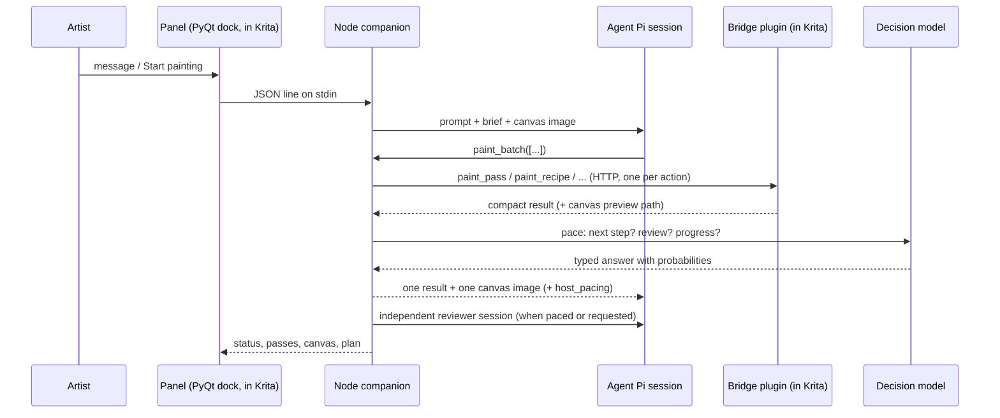

# Architecture

Three processes cooperate. Krita owns the canvas, the companion owns the agent, and the model providers are remote.

## Plugin (`plugin/kritamcp`)

- **`__init__.py`**: an HTTP server on `127.0.0.1:5678`. Requests are queued and executed on Krita's main thread (`command_queue.py`), because Krita's API is not thread-safe.
- **`creative_tools.py`**: the *creative* operations the agent uses:
  - `begin` and `observe`;
  - `paint_pass` (native cubic strokes);
  - `painting_toolbox` (edits on a reversible copy);
  - `adjust_layer`;
  - `review_pass` (fade, hide or reject a pass);
  - `checkpoint` and `end`.

  Each operation is validated (`creative_validation.py`), is idempotent by operation id, and is recorded in an operation journal and a pass history next to the study.
- **Saving:** full `.kra` saves happen every 5 actions or 60 seconds, and always at review, run end, `end` and the artist's pass-review actions. Between saves an action only re-reads the canvas.
- **`creative_docker.py`**: the Creative Agent panel (chat, plan dialog, pass history, settings). It starts the companion as a child process and talks to it with JSON lines.

## Companion (`companion/src`)

| Module | Role |
|---|---|
| `main.mjs` | Process entry: config, the JSON-line protocol with the panel, shutdown |
| `studio.mjs` | `StudioRuntime`: chats (studies), modes (Ask / Plan / Agent), the plan brief, the run loop (`runGoal`), reviews (`reviewCanvas`), pacing (`afterPainting`), recovery, persistence |
| `runtime.mjs` | `PaintingRuntime`: Pi session lifecycle, event handling, the context transform that keeps only recent canvas images |
| `tools.mjs` | Painting tools exposed to the model, `paint_batch`, and lean model-visible results (`modelResultText`) |
| `recipe-tool.mjs`, `contour-tool.mjs`, `reference-tool.mjs` | Higher-level painting tools built on native passes |
| `pacing.mjs` | Decision-model pacing: questions, the host's action policy, stall detection |
| `luna-decisions.mjs`, `routing.mjs`, `visual-checks.mjs` | Decisions API client, request routing, per-pass defect checks, review progress |
| `langfuse-tracing.mjs` | Optional Langfuse tracing: sessions, generations, tools, scores, typed decisions |
| `decision-records.mjs` | Typed decisions for the decision-model dataset |
| `bridge.mjs` | HTTP client for the plugin |

### A run, step by step

1. **Plan.** In Plan mode the model may only ask questions and propose a brief: requirements, freedoms, ordered steps and completion checks. The artist accepts it with **Start painting**.
2. **Paint.** `runGoal` gives the painter the brief, the reference images and the current canvas. The painter sends `paint_batch` calls, each with 1–10 actions. Every action goes through `callNative`, which checks the plan revision and handles uncertain outcomes by observing, acknowledging and continuing.
3. **Pace.** After each painting call, `afterPainting` asks the decision model whether to continue the current step, move to the next one, or call the reviewer. The answer is acted on by the host and reported back in the tool result.
4. **Review.** `reviewCanvas` starts a separate reviewer session that sees only the references, the brief, the native technical evidence and the whole canvas. It must submit evidence for every check. The host marks the painting complete only when every check is met.
5. **Repeat or finish.** A failed review feeds its unmet checks into the next painting turn. Repeated failures without progress trigger a change of strategy. Only the artist's **Stop** or a hard failure pauses the run.

## Data on disk

Each chat is a *study* in `<paintings folder>/.creative-agent/studies/<id>/`:

| Path | Contents |
|---|---|
| `goal.json` | Plan, status, reviews, progress, pacing history |
| `study.json` | Model, references, target document |
| `sessions/`, `reviews/`, `preparations/` | Pi transcripts |
| `.previews/` | Canvas images |
| `.passes.json`, `.operations.json` | The plugin's pass history and journal |
